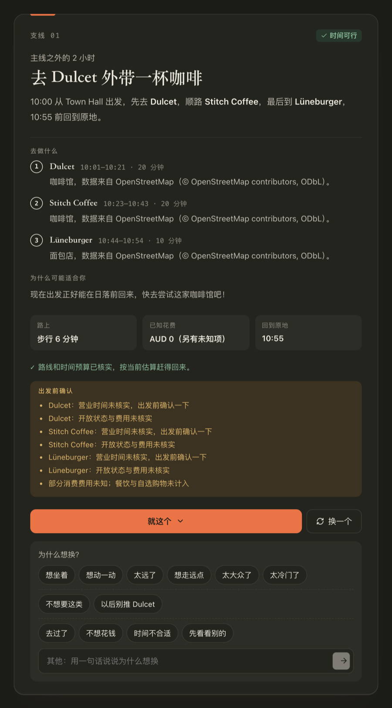
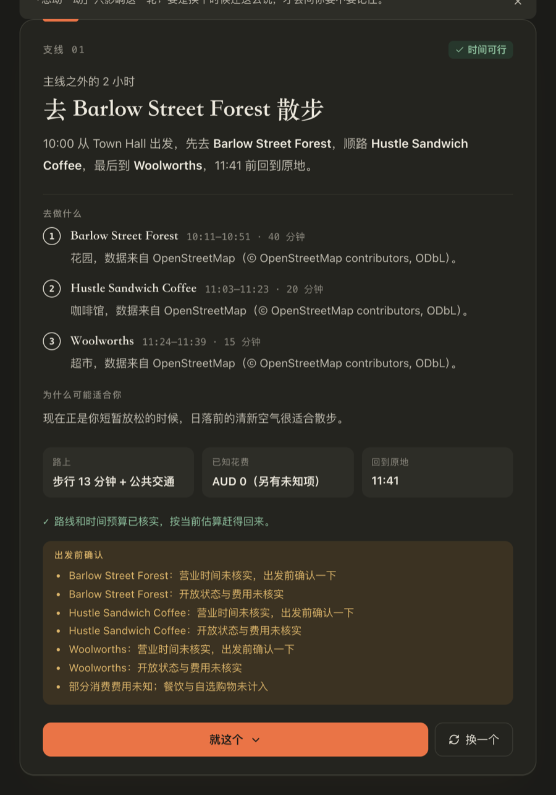
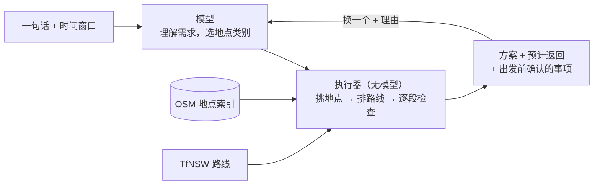
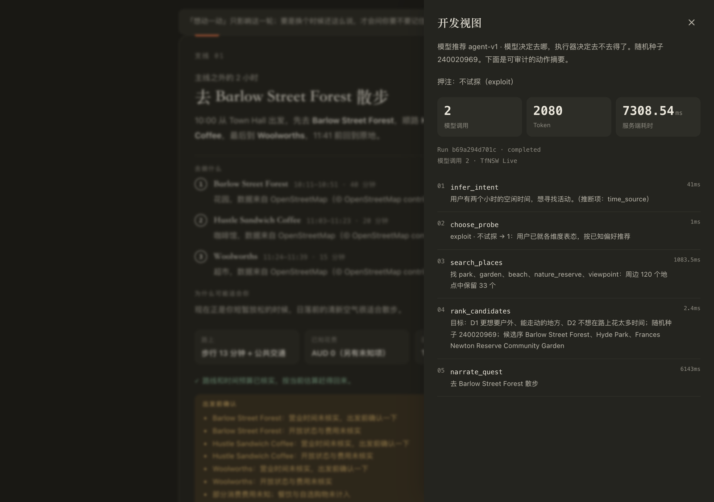
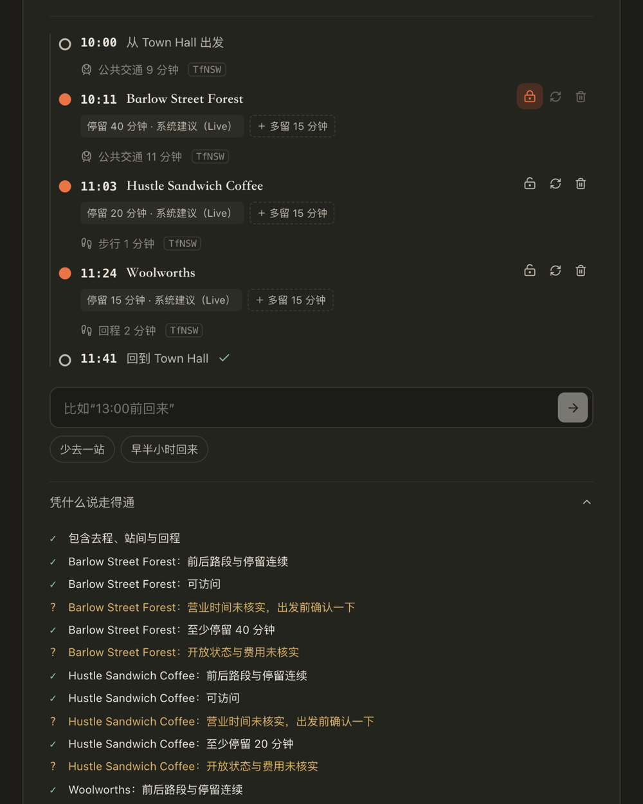

# Sidequest

[](https://github.com/Cheryl-29/sidequest/actions/workflows/ci.yml)

**有一小时空闲，想出门，但不知道去哪。Sidequest 在附近的真实地点里挑一个去处，逐段核对你能不能按时回来；查不到的信息，明说查不到。**

悉尼短时出行决策原型 · OpenStreetMap 地点快照 · TfNSW 公交路线 · FastAPI + React/TypeScript

## 为什么做这个项目？

“午休还有一小时，想出去透透气”这件事，现有工具都接不住：

- **地图 App** 默认你已经知道要找什么（“附近的咖啡馆”）。
- **行程规划工具** 要你先定目的地，再按一整天来排。
- **通用聊天助手** 能给建议，但没有机制保证它核对过营业时间和回程；信息缺失时，也没有机制要求它说出缺了什么。

结果是用户自己选活动、查地点和路线、算停留时间、确认能否按时返回；不满意就再来一遍。Sidequest 把这些步骤连成一个流程：**输入出发点、可用时间和当下需求，得到一个具体方案、预计返回时间，以及仍需确认的信息。** 首要场景是午休和下班后；时间窗口最长四小时。

## 一次使用

1. 输入“午休想出去走走”，设置从 Town Hall 出发、可用一小时。
2. 系统检索附近地点，选一个去处，并检查包含停留时间的往返计划。
3. 你看到推荐、预计返回时间和“出发前确认”的事项（例如营业时间没查到）。
4. 不满意就换一个，并选一个理由；系统重新选择、重新检查，而不是只改一段推荐文案。

| 输入需求和时间 | 带理由换一个 | 查看新方案 |
|---|---|---|
|  |  |  |

截图来自早期版本，界面文字以当前运行版本为准。

## 它怎么工作



分工只有一条：**模型决定去哪，执行器决定去不去得了。** 由此得到三条规则：

1. **模型给不出时间、费用和可行性结论。** 模型只输出结构化的意图和地点类别（JSON Schema 限定范围）；具体地点来自检索结果，时间和结论全部由执行器计算。模型选得不合适，后果是“不够有趣”，执行器仍会拦下已知的时间冲突。
2. **缺失的事实保持缺失。** 没查到营业时间，不会被当成“开着”，而是列进“出发前确认”；没查到票价，不会被当成 0。已知的关门时间则直接判定失败。
3. **可行性按整条链判定。** 去程、停留、站间、回程连起来检查。每个地点各自到得了，不代表连起来赶得回来。

每项检查的结果是 `pass | fail | unknown`。有任何 `fail`，方案即不可行。`unknown` 永远不算通过：营业时间这类地点信息没查到，列为“出发前确认”；路线等关键事实没查到，方案降为“有条件”。

## 和通用助手的区别

区别不在模型，而在结构：哪些结论允许由模型给出。

| | 通用助手 + 工具 | Sidequest |
|---|---|---|
| 能不能按时回来 | 模型可以去查路线，也可以不查就回答 | 结论只来自执行器，模型没有输出它的通道 |
| 信息缺失时 | 没有约束阻止它按“应该开着”处理 | 保持 `unknown`，并列给用户看 |
| 多个站点 | 每个地点各自可达即可 | 按整条链判定 |
| 不满意换一个 | 重新生成一段推荐 | 理由改变下一轮选择，新方案重新走完整检查 |

这分成两层，请分开看：

- **已经成立的：** 上面是系统的结构性质，由单元测试和 24 个冻结场景的回归（`make eval`）覆盖，不依赖模型当次表现。
- **还没证明的：** 这套流程是否真的比通用助手更省事。目前只有工程评测和合成用户实验，没有真实用户证据；验证计划见 [项目定位](docs/product-positioning.md)。

## 换一个：理由分三类

每次“换一个”都带一个理由，不同理由做不同的事：

| 类别 | 例子 | 效果 |
|---|---|---|
| 改条件 | 不想花钱、时间不对 | 修改这次请求的硬条件 |
| 改方向 | 想坐着、想动一动、太远了、不要这类 | 调整下一轮的排序 |
| 只排除 | 去过了、再也不去这里 | 排除这个地点，不推断口味 |

两个容易做错、这里刻意没做的地方：“去过了”不代表不喜欢（可能正是喜欢才去过）；“太远了”只让下一轮偏近，不会被悄悄改写成一个步行上限。

同方向的理由在多次使用中重复出现时，系统会问要不要记住；只有你确认的才会保存，随时可以查看和删除，而且你当下说的话始终优先于记忆。这是辅助能力，是一套可审计的规则，不是模型训练。细节（代码里的 7 个理由作用域、记忆条目与情境）见 [`docs/architecture.md`](docs/architecture.md)。

## 两种运行方式

不配置任何 Key 就是离线演示。两个 Key 各自打开一样东西，互不依赖：

| | 没有 Key | 有 Key |
|---|---|---|
| 路线（`TFNSW_API_KEY`） | 合成回放，不能据此出门 | TfNSW 公交接口 |
| 谁来选地点（`OPENAI_API_KEY`） | 固定规则，不调用模型 | 模型 |

固定规则同时是兜底：模型出错、超时（45 秒），或它选的地点全部没通过检查时，系统自动退回固定规则，并在界面上说明原因。

## 可靠性

- **迟到的结果不会覆盖新状态。** 任务异步执行，进度通过 SSE 推送；写入结果时用 compare-and-swap 确认任务仍在运行，已取消或被取代的请求不会被写回。服务重启时，未完成的任务标记为 `interrupted`。
- **路线缓存按出发时刻区分。** 缓存键包含精确出发时刻，改了时间不会复用旧路线。
- **用户输入不拼接 URL。** 外部接口地址是固定常量，API Key 只放在请求头里，不进 URL、日志或缓存；有专门的提示注入测试。
- **推荐文案受检查。** 文案引用的证据 id 要和真实证据核对，编造的直接丢弃；没有已确认的记忆时，“你说过 / 你喜欢”这类话会被删掉。这只核对引用是否存在，不核对文案说得对不对。

## 评测

四项评测，前三项可以离线复现；完整表格、读法和局限见 [`docs/evaluation.md`](docs/evaluation.md)。

| 评测 | 回答的问题 | 结果 |
|---|---|---|
| 冻结场景回归（`make eval`，在 CI 中运行） | 硬约束有没有被破坏 | 24/24 通过 |
| 暴力参考规划器 | 固定规则有没有漏掉可行解 | 22/22 命中 |
| 未经检查的模型基线 | 没有执行器检查会怎样 | 见下 |
| 合成用户跨会话实验 | 读理由、记偏好有没有用 | 见下 |

未经检查的模型基线：同样的 24 个场景，让 gpt-4o-mini 一次性给出方案，再用验证器打分（每组 72 个回答）。

- **模型从不说“不行”：** 216 个回答全部给了方案并确认可行，包括无解的场景（18/18）。
- **把事实给全也没用：** 提示里给出全部路段时间后，有解场景仍有 16/66 的方案不可行；不给时是 13/66。
- **短窗口最差：** 一小时左右的两个场景 18 次全部不可行，模型多数时候仍然排三站。
- **缺失的事实多数没被说出来：** 隐去营业时间后，41 个相关方案里只有 6 个把缺失全部标出。

同样的场景下，Sidequest 的固定规则给出 22 个方案，0 个不可行，2 个无解场景都没有硬给方案。这是单次回答、不带工具的较小模型，不代表完整的通用助手产品。

合成用户实验（开发集 44 个会话，gpt-4o-mini）的三个读数：

- **读理由有用：** 3 轮内被接受，从 29/44（不读理由）到 44/44。
- **记偏好有用：** 首轮被接受，从 22–23/44（无记忆）到 34/44。
- **复杂记忆的收益有限：** 最简单的扁平画像首轮同样是 34/44；按情境区分的记忆只赢在“问得更准”（提议被接受 5/5，扁平画像 6/12）。

这些实验检验的是机制，场景和用户都是合成的，不代表真实用户满意度，也不证明真实使用中比通用助手更省事。

## 能力边界

- 仅支持悉尼。地点来自 OSM 快照，描述只有标签信息，所以推荐文案偏平淡。
- “已验证”表示在已有数据和规则下检查通过，不保证实际准时返回。OSM 的营业时间不可靠，目前只作提示。
- 没有账号体系，身份是随机会话 Cookie；清掉 Cookie 就会失去已保存的偏好。
- 不包含排队信息、预订或自动执行出行；不是全天旅游规划工具。
- 连续换几次都不满意时，目前没有收场路径。

## 快速开始

需要 Python 3.12+、Node.js 20+。

```bash
make install       # venv + 后端依赖 + 前端依赖
make places-demo   # 用仓库内的 OSM 探针快照离线构建小索引（157 个地点）
make run           # 构建前端并启动服务
```

打开 <http://127.0.0.1:8000>。不配置任何 Key 时就是离线演示，全程不需要联网。

想启用真实路线和模型，在项目根目录的 `.env` 中写入：

```bash
TFNSW_API_KEY=...     # 真实公交路线
OPENAI_API_KEY=...    # 模型选地点（可选 OPENAI_MODEL / OPENAI_BASE_URL）
```

完整的悉尼索引（10,247 个地点）需要先运行 `scripts/fetch_places.py` 抓取 Overpass 快照，再用 `scripts/build_places.py` 构建；`make places-demo` 不会覆盖已有的索引。

验证（与 CI 一致）：

```bash
make test         # ruff + pytest（211 项）+ 前端类型检查与构建
make eval         # 24 个冻结场景
make dimensions   # 口味维度闸门
```

在终端里直接驱动一轮（会调用真实模型）：

```bash
PYTHONPATH=backend .venv/bin/python scripts/run_agent.py --say "下午空出来了" --hours 3 --reroll want_move
```

## 代码结构

```text
backend/sidequest/      FastAPI 后端，约 5k 行
  planner.py            固定规则规划器与全链条验证器（核心）
  providers.py          TfNSW 路线适配器
  places.py             OSM 地点索引与检索
  agent.py / llm.py     模型一轮：理解需求 → 选类别 → 排序 → 锁定一站 → 写文案
  taste.py / memory.py  换一个的理由；经确认的偏好
  moment.py             “为什么是现在”的可引用事实（日落、时间窗口、路段）
  api.py / storage.py   异步任务、SSE、owner 隔离的 SQLite 文档存储
  personas.py / harness.py / reference.py   合成用户、跨会话实验、暴力参考规划器
  baseline.py           未经检查的模型基线：模型直接给方案，再用验证器打分
backend/tests/          211 项测试
frontend/src/           React + TypeScript 单页
evals/                  冻结场景与合成用户定义
reports/                评测产物
```

界面里的开发视图可以看到每一轮模型选了什么、调用了几次、每一步耗时；行程详情列出每一项检查及其依据。

| 可审计的动作 Trace | 时间线与“凭什么说走得通” |
|---|---|
|  |  |

## 文档

- [`docs/product-positioning.md`](docs/product-positioning.md)：定位、已成立与待验证的主张、下一阶段验证计划
- [`docs/architecture.md`](docs/architecture.md)：请求生命周期、模型与执行器的边界、理由与记忆规则、证据与缓存
- [`docs/evaluation.md`](docs/evaluation.md)：三层评测的完整结果与局限
- [`docs/data-feasibility.md`](docs/data-feasibility.md)：真实数据探针与许可
- [`Sidequest_项目计划_v2.md`](Sidequest_项目计划_v2.md)：一页取舍记录——做过哪些决定、为什么

## 数据来源

地点数据 © OpenStreetMap contributors，遵循 [ODbL](https://opendatacommons.org/licenses/odbl/) 许可；路线数据来自 Transport for NSW Open Data Hub。
